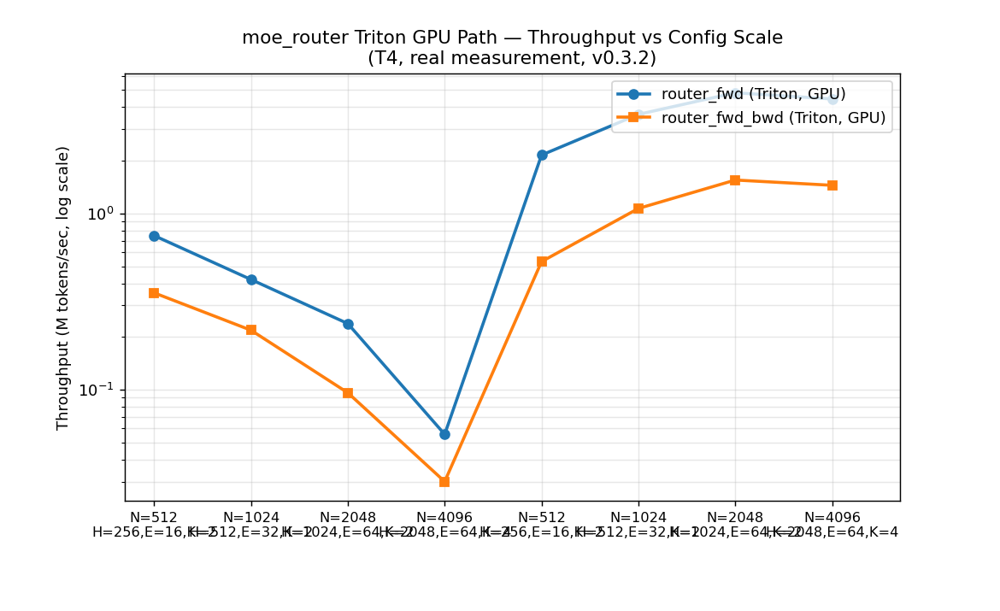
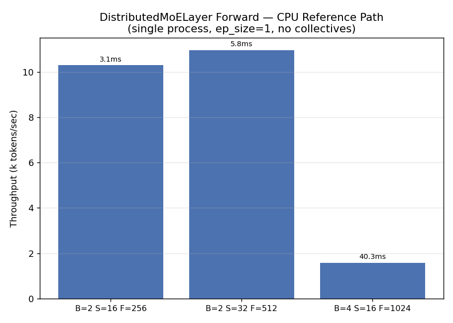
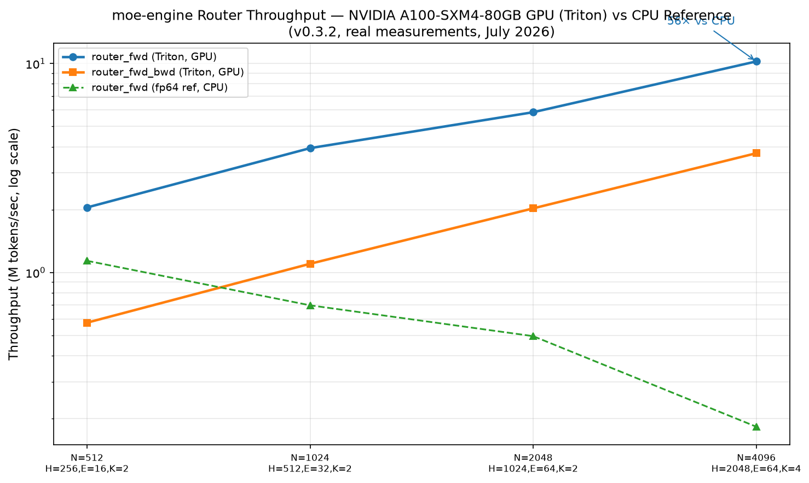

<div align="center">

# `moe-engine` · Composed Mixture-of-Experts Engine

**A research-grade runtime for Mixture-of-Experts training**

[](https://github.com/Mattral/Composed-Mixture-of-Experts-Engine/blob/main/LICENSE)
[](https://pytorch.org/)
[](https://triton-lang.org/)
[](https://github.com/Mattral/Composed-Mixture-of-Experts-Engine/blob/main/moe-engine/tests/)
[](docs/adr/ADR-005-gpu-architecture-portability.md)
[](https://github.com/Mattral/Composed-Mixture-of-Experts-Engine/blob/main/RESULTS.md#fault-tolerance--chaos-test-results)
[](https://github.com/Mattral/Composed-Mixture-of-Experts-Engine/pulls)
[](https://github.com/Mattral/Composed-Mixture-of-Experts-Engine/releases)

</div>

> **v0.3.3 (pre-release, 2026-11-20).** Includes the October 2026 correctness work: autograd-aware EP, TP and SP collectives, replicated-gradient sync, a layout-independent global-mean objective, router auxiliary losses, capacity dropping before dispatch, and global gradient-norm clipping ([ADR-010](docs/adr/ADR-010-backward-correctness-and-replicated-gradients.md), [ADR-011](docs/adr/ADR-011-layout-independent-global-mean-objective.md)). Each is checked against a dense single-device reference on CPU with Gloo. See [`CHANGELOG.md`](CHANGELOG.md).

---

## What this is

`moe-engine` is a **research-grade infrastructure runtime** for training large Mixture-of-Experts (MoE) language models. The design target is large clusters. Validation today covers the router kernel on single GPUs (T4, A100), and EP, TP, SP and FSDP2 data parallelism on CPU with Gloo at 2 and 4 processes, compared against a dense single-device reference in push CI. Pipeline parallelism across processes does not work yet. Multi-GPU, NCCL and multi-node runs remain open. See [Status](#what-is-actually-built).

**This is not a model definition.** It is the systems layer (Triton kernels + 4D parallelism + checkpoint and recovery code + observability) that a real MoE model runs on.

Documented router speedup at N=4096, H=2048, E=64, K=4 is **80.1× (T4) / 56.0× (A100) versus the CPU reference path; no GPU baseline comparison yet**. The CPU baseline differs by host (0.056 M tok/s in the T4 table, 0.183 M tok/s in the A100 table).

Core capabilities:
- Fused **Triton router kernel** (single HBM pass, analytic backward pass). Push CI runs the CPU path. The Triton GPU job is `workflow_dispatch` only and was skipped on the latest push.
- **4D parallelism** — Data (FSDP2) × Expert (all-to-all) × Tensor (Column/RowParallel + Sequence Parallel) × Pipeline (1F1B with activation tagging). DP, EP, TP and SP are tested across processes in push CI. Pipeline parallelism is tested as single-process scheduling; its 2-process tests fail.
- **Training objective**: the mean over the global batch's loss-bearing tokens, independent of the dp/ep/tp layout and the gradient-accumulation count (ADR-011)
- Runtime invariant checks (token conservation, NaN guards, index validity)
- Scenario A (node kill) recovers in ~17/20 runs (failures attributed to a Gloo race in containers). Scenario B (storage stall) is recorded at 10/10 and runs via `workflow_dispatch` only, not on push CI.
- **Async two-tier checkpointing** (pinned-host → NVMe O_DIRECT → S3/MinIO with atomic rename), covered by the CPU test suite
- MoE-aware telemetry (JSONL, plus optional TensorBoard, Prometheus, and WandB sinks)

---

## Architecture

```
┌─────────────────────────────────────────────────────────────────┐
│                        Training Loop                            │
│  train.py  ←  load_config  ←  configs/{default,smoke}.yaml      │
└───────────────────┬─────────────────────────────────────────────┘
                    │
     ┌──────────────▼───────────────┐
     │   DistributedMoELayer        │  pkg/distributed/parallel_mesh.py (shim)
     │                              │  → moe_layer.py + expert_parallel.py
     │  ┌──────────┐ ┌──────────┐   │
     │  │MoERouter │ │ Experts  │   │  pkg/kernels/moe_router.py
     │  │(Triton)  │ │(SwiGLU)  │   │
     │  └────┬─────┘ └────▲─────┘   │
     │       │  EP a2a     │        │
     │  ┌────▼──────────────────┐   │
     │  │  all_to_all dispatch  │   │  dedicated CUDA stream
     │  │  all_to_all combine   │   │  compute-comm overlap
     │  └───────────────────────┘   │
     └──────────────┬───────────────┘
                    │
     ┌──────────────▼───────────────┐
     │   ElasticTrainerHarness      │  pkg/elastic/fault_monitor.py
     │                              │
     │  AsyncCheckpointer           │  background I/O threads
     │    NVMe tier  (fast)         │  pinned host → O_DIRECT write
     │    S3/MinIO   (durable)      │  atomic rename + remote mirror
     │                              │
     │  ClusterStateMachine         │  heartbeat → evict → reshard
     │    evict dead ranks          │  → reload → resume (no restart)
     │    reshard expert owners     │
     └──────────────┬───────────────┘
                    │
     ┌──────────────▼──────────────┐
     │   Telemetry                 │  pkg/telemetry/logger.py
     │   JSONL + TensorBoard       │  real CUDA event timing
     │   Prometheus /metrics       │  routing + overlap metrics
     │   WandB (optional)          │  WANDB_API_KEY-gated
     └─────────────────────────────┘
```

**4D Parallelism mesh:** `(dp × tp × pp × ep)`
- **DP** — FSDP2 per-parameter sharding via DTensor along the data axis. Expert weights are sharded over DP as well (expert-data-parallel, ADR-011). Gradients are summed over DP and divided once by the global token count. Tested at dp=2 on CPU/Gloo.
- **EP** — Expert Parallelism: each rank owns `E / ep_size` experts; non-blocking `all_to_all_single` dispatch + combine on a dedicated high-priority CUDA stream with compute overlap. The all-to-all is autograd-aware and tested at ep=2 and ep=4 on CPU/Gloo; the CUDA-stream path has not been run with ep > 1.
- **TP** — Tensor Parallelism on expert FFNs (`ColumnParallelLinear` / `RowParallelLinear`) + Sequence Parallelism, including non-divisible sequence lengths. The fused `next_weight` path applies a replicated weight to the local sequence shard with zero collectives (ADR-007).
- **PP** — Pipeline Parallelism with `PipelineStage` + 1F1B schedule and activation tagging. Single-process scheduling is tested. Multi-process `run_1f1b_distributed` is open: its 2-process tests fail (see the status table).

See `docs/ARCHITECTURE.md` for the detailed internal data-flow diagram (Triton router internals, dedicated-stream mechanics, token lifecycle, and per-layer forward/backward pass).

---

## T4 GPU Validation (June 2026) — Key Results

All numbers below are **real measurements** from `moe-engine/benchmarks/gpu_results_t4.json`.  
Reproduce everything: see [`notebooks/moe_engine_v032_T4_validation.ipynb`](moe-engine/notebooks/moe_engine_v032_T4_validation.ipynb) (13 sections, open in Colab with T4).

### Router throughput — CPU vs T4 GPU (Triton kernel)

| Config                  | CPU (M tok/s) | T4 GPU (M tok/s) | Speedup   |
|-------------------------|---------------|------------------|-----------|
| N=512, H=256, E=16, K=2 | 0.747         | 2.141            | **2.9×**  |
| N=1024, H=512, E=32, K=2| 0.421         | 3.644            | **8.7×**  |
| N=2048, H=1024, E=64, K=2 | 0.236       | 4.832            | **20.4×** |
| N=4096, H=2048, E=64, K=4 | 0.056       | 4.454            | **80.1×** |

Speedup in this table is versus the CPU reference path on the T4 host. There is no GPU baseline comparison yet.

### GPU router throughput chart (v0.3.2, T4, real measurements)



*Forward-only (blue) and forward+backward (orange) throughput on T4 GPU (Triton kernel) vs CPU reference path (green dashed). Log scale.  
Source: `moe-engine/benchmarks/gpu_results_t4.json`, June 2026 T4 validation run.*

> **Note:** If the chart image is not yet present in `moe-engine/benchmarks/charts/`, run Section 9 of the validation notebook on a T4 and copy `router_throughput_gpu_v0_3_2.png` into that folder.

### MoE layer throughput (v0.3.1, CPU, real measurements)



*Full `DistributedMoELayer` forward (orange) vs single dense SwiGLU FFN baseline (blue) on CPU.  
Source: `benchmarks/cpu_results_colab.json`.*


---


### A100 GPU Validation — July 2026

Second real-GPU validation, on an NVIDIA A100-SXM4-80GB via Lightning AI
Studio. This run surfaced and fixed a Turing-vs-Ampere `tl.dot` tensor-core
minimum tile size defect invisible on T4, plus a `used_triton` telemetry
correctness bug — both documented in
[`docs/adr/ADR-005-gpu-architecture-portability.md`](docs/adr/ADR-005-gpu-architecture-portability.md).

**Hardware:** NVIDIA A100-SXM4-80GB, 81920 MiB, driver 580.159.03
**Software:** torch 2.8.0+cu128, CUDA 12.8



*Forward-only (blue) and forward+backward (orange) throughput on A100
(Triton kernel) vs CPU reference path (green dashed). Log scale.
Source: `benchmarks/gpu_results_a100.json`, July 2026 validation run.*

#### Router throughput — CPU vs A100

Speedup here is versus the CPU reference path on the A100 host (0.183 M tok/s at N=4096 in this table, versus 0.056 M tok/s in the T4 table). There is no GPU baseline comparison yet. Cells are the `tokens_per_sec` values in `moe-engine/benchmarks/gpu_results_a100.json`, rounded to 3 decimals for M tok/s.

| Config | CPU (M tok/s) | A100 (M tok/s) | Speedup |
|--------|:-------------:|:--------------:|:-------:|
| N=512, H=256, E=16, K=2 | 1.138 | 2.048 | 1.80× |
| N=1024, H=512, E=32, K=2 | 0.697 | 3.938 | 5.65× |
| N=2048, H=1024, E=64, K=2 | 0.496 | 5.851 | 11.80× |
| N=4096, H=2048, E=64, K=4 | 0.183 | 10.240 | **56.0×** |

#### Router forward+backward — CPU vs A100

| Config | CPU (M tok/s) | A100 (M tok/s) | Speedup |
|--------|:-------------:|:--------------:|:-------:|
| N=512, H=256, E=16, K=2 | 0.416 | 0.575 | 1.38× |
| N=1024, H=512, E=32, K=2 | 0.352 | 1.101 | 3.13× |
| N=2048, H=1024, E=64, K=2 | 0.289 | 2.028 | 7.02× |
| N=4096, H=2048, E=64, K=4 | 0.097 | 3.724 | **38.4×** |

Reproduce with
[`moe-engine/notebooks/moe_engine_A100_validation.ipynb`](moe-engine/notebooks/moe_engine_A100_validation.ipynb).

**GPU architecture support matrix** (full detail in ADR-005):

| Architecture | Status | Validated |
|---|---|---|
| NVIDIA T4 (Turing, sm_75) | ✅ | June 2026 |
| NVIDIA A100-SXM4-80GB (Ampere, sm_80) | ✅ | July 2026 |
| NVIDIA H100 (Hopper, sm_90) | ❌ Not yet tested | — |


---

### Chaos resilience

| Scenario              | Description                        | Runs | Pass Rate    |
|-----------------------|------------------------------------|------|--------------|
| **Scenario B**        | Storage stall (10s I/O delay)      | 10   | **10/10**    |
| **Scenario A**        | Node kill + recovery (SIGKILL)     | 20   | **~17/20**   |

Both rows are recorded results from manual runs (see `RESULTS.md`). The Chaos B job is `workflow_dispatch` only and has no recorded run in this repository's Actions history; there is no CI job for Scenario A.
Scenario A recovers in ~17/20 runs (failures attributed to a Gloo race in containers). A change from Gloo to NCCL in the chaos harness is planned for v0.4.

See **[`RESULTS.md`](RESULTS.md)** for every real number with exact reproduction commands and full telemetry samples.

---

## What is Actually Built

Status as of 2026-11-23 (v0.3.3, CPU torch 2.14.1). ✅ means a test or recorded run shows it, and the Evidence column says which. "Push CI" is the `test-cpu` (Tier-0), `test-differential`, `test-config` and `benchmark` jobs in `.github/workflows/ci.yml`. The `docker`, `test-gpu` and `chaos-b` jobs are `workflow_dispatch` only and have no recorded run in this repository's Actions history. "Manual" means a run outside CI, named in the row.

| Component | Status | Evidence | Detail |
|---|---|---|---|
| **Triton router — forward** | ✅ | Push CI (CPU reference path); T4 and A100 notebooks (Triton path) | Fused matmul+softmax+topK+renorm in one HBM pass; 64×64 SRAM tiles. 80.1× (T4) and 56.0× (A100) versus the CPU reference path at N=4096; no GPU baseline comparison yet. |
| **Triton router — backward** | ✅ | Push CI (CPU reference path); T4 and A100 notebooks | Analytic Jacobian; `atol=rtol=1e-5` vs an fp64 reference; 31 cases in `test_kernels_numerics.py` (forward, backward, determinism, edge cases). |
| **Token conservation invariant** | ✅ | Push CI: `benchmark` job (`violations=0/100`), `test_router.py`, `test_kernels.py` | `sum(dispatch_cnt) == N×K` every forward. The 2-process version (`test_distributed_invariants.py`) passes when run manually; no push job runs it. |
| **Expert load imbalance metric** | ✅ | Push CI: `test_telemetry.py`, `test_routing_quality.py` | `max/mean` load per step, emitted in telemetry. |
| **Router auxiliary losses** | ✅ | Push CI: `test_router_losses.py` (Tier-0), `test_layout_*[aux-*]` (differential) | Tensor-valued z-loss and Switch load-balancing loss from every MoE layer, with global expert fractions over DP × EP (ADR-011, F5). Defaults: `load_balance_weight=1e-2`, `z_loss_weight=0.0`. |
| **EP all-to-all (dispatch + combine)** | ✅ CPU/Gloo | Push CI: `test_differential.py`, `test_comm_ops.py` | Autograd-aware `all_to_all`; output and every gradient match a dense reference at ep=2 and ep=4, including `E % ep_size != 0`. |
| **Compute-comm overlap (dedicated CUDA stream)** | ❌ Not verified | None | The stream code is in `expert_parallel.py`. No test or GPU run with ep > 1 exercises it (ADR-010). |
| **Overlap ratio telemetry** | ✅ field | Push CI: `test_telemetry.py` | `dispatch_ms / expert_compute_ms` recorded every step. Reads 0.0 on single-rank CPU runs. |
| **DP via FSDP2** | ✅ CPU/Gloo, dp=2 | Push CI: `test_differential.py` (dp2, dp2×ep2, dp2×sp2), `test_grad_sync.py` | `fully_shard` along DP; expert weights are sharded over DP too (expert-data-parallel, ADR-011). Needs the FSDP2 sum-reduction methods present in the pinned torch 2.14.1. dp > 2, NCCL and GPU not run. |
| **Tensor Parallelism** | ✅ CPU/Gloo, tp=2 | Push CI: `test_differential.py`, `test_comm_ops.py`, `test_train_step.py` (tp=2 step). Manual: `*_2rank` cases in `test_tensor_parallel.py` pass | `ColumnParallelLinear` + `RowParallelLinear` with conjugate collectives; `w_gate`/`w_up` column-parallel, `w_down` row-parallel (ADR-008, ADR-010). |
| **Sequence Parallelism** | ✅ CPU/Gloo, sp=2 | Push CI: `test_differential.py` (sp2, dp2×sp2, ep2×sp2). Manual: `*_2rank` cases in `test_sequence_parallel_v03.py` pass | `scatter/gather` with non-divisible sequence lengths. The fused `next_weight` path applies a replicated weight with zero collectives (ADR-007); its tests are among the manual `*_2rank` cases. |
| **Global-mean objective + gradient clipping** | ✅ CPU/Gloo | Push CI: `test_differential.py` (`test_layout_*`, `clip-*`, 7 layouts), `test_train_step.py` | Mean over the global batch's loss-bearing tokens; one global grad norm over DP, EP and TP shards (ADR-011, F22, F14). |
| **Capacity dropping** | ✅ | Push CI: `test_capacity_dropping.py` (Tier-0), EP capacity cases (differential) | Per expert across top-k slots, slot-major, dropped before dispatch (ADR-011, F12). Opt-in via `capacity_dropping`. |
| **Pipeline Parallelism — scheduling** | ✅ single process | Push CI: `test_pipeline_parallel.py` (25 single-process cases) | `PipelineStage`, `run_1f1b` warmup / steady / cooldown phases. |
| **Pipeline Parallelism — multi-process** | ❌ Open | Manual, 2026-11-23, Linux: both `test_pp_multiprocess_*` tests fail | `run_1f1b_distributed` over `dist.send/recv` with activation tagging. The last stage runs 0 of the expected micro-batches, and stage 0 then reports `Connection closed by peer`. ADR-010 reports a hang on Windows. |
| **MFU accounting** | ✅ | Push CI: `test_mfu.py`, `test_mfu_v02.py` | MoE-sparse formula `(K/E)×P_expert`; streaming `MFUAccountant`. |
| **Pydantic `MoEConfig`** | ✅ | Push CI: `test_config.py` (38, in Tier-0 and the config job) | Validated hierarchy; env-var overrides; field-level errors. |
| **Async two-tier checkpointing** | ✅ CPU | Push CI: `test_elastic.py`, `test_elastic_v02.py`. Manual: `test_smoke_e2e.py` (S3 tier under moto) | Local tier (chunked writes, atomic rename) and `file://` remote tier in push CI. The S3/MinIO tier is tested only in `test_smoke_e2e.py`, which no CI job runs. |
| **TorchElastic recovery** | ✅ unit level | Push CI: `test_elastic*.py` | Evict → reshard (round-robin) → reload. The SIGKILL scenario is Chaos A below. |
| **Structured JSONL + multi-sink telemetry** | ✅ | Push CI: `test_telemetry.py` | Thread-safe JSONL. Optional TensorBoard, Prometheus and WandB sinks (WandB tested with a mocked client). A zero-cost claim for disabled sinks is not yet validated. |
| **End-to-end train loop** | ✅ CPU, single rank | Manual: `test_smoke_e2e.py` (3 passed), `train.py --smoke` | Config → topology → model → steps → checkpoint. Ignored by the Tier-0 job; the GPU smoke step is in the manual `test-gpu` job. |
| **Benchmark suite** | ✅ CPU | Push CI: `benchmark` job (15 entries) | CPU + GPU sweeps; JSON/CSV output; chart generation. The GPU sweep runs in the manual `test-gpu` job. |
| **Typer CLI** | ⚠️ No tests | Manual: `info` and `validate` run 2026-11-23 | `python scripts/cli.py train / benchmark / validate / info`. No `moe` console script is declared in `pyproject.toml`. |
| **Docker + docker-compose** | Not run in CI | None | Multi-stage image; 1/4/8-GPU targets + monitoring stack. The `docker` job is manual and has no recorded run. |
| **Kubernetes manifests** | Not tested | None | Single-node Job + multi-node Indexed Job with etcd rendezvous; PVC for checkpoints. |
| **Chaos Scenario B (storage stall)** | Manual | `RESULTS.md` (10/10, i9 workstation); repeated 10/10 on 2026-11-23 on a laptop CPU (WSL, `--count=10`) | The `chaos-b` job is `workflow_dispatch` only and has no recorded run. |
| **Chaos Scenario A (node kill)** | ⚠️ ~17/20 | `RESULTS.md` (i9 workstation) | Failures attributed to a Gloo race in containers. No CI job. Not re-run for this update. |
| **Nsight/CUPTI profiling** | ❌ Planned v0.4 | — | Requires GPU hardware + sustained runs. |
| **Multi-GPU, NCCL, multi-node runs** | ❌ Planned v0.4 | — | Requires GPU cluster access. |

---

## Getting Started

### Prerequisites
- Python ≥ 3.10
- PyTorch ≥ 2.5
- Triton ≥ 3.0 (optional — CPU fallback always works)
- CUDA ≥ 12.4 (optional)

### 1. Clone & Install
```bash
git clone https://github.com/Mattral/Composed-Mixture-of-Experts-Engine.git
cd Composed-Mixture-of-Experts-Engine/moe-engine
pip install -e ".[dev]"
```

### 2. Validate Configs
```bash
make validate-config
# or
python scripts/validate_config.py configs/
```

### 3. CPU Smoke Test (no GPU, ~5–10 s)
```bash
make smoke
# or
python train.py --config configs/smoke.yaml --smoke
```
Expected: 2 steps, JSONL telemetry at `/tmp/moe-engine/logs/step.jsonl`.

### 4. CPU tests
```bash
make test-cpu
```
`make test-cpu` is wider than the push CI Tier-0 job: it does not ignore `test_differential.py`, `test_comm_ops.py`, `test_grad_sync.py`, or `test_train_step.py`.

Tier-0 selection: `417 passed, 3 skipped, 15 deselected, 1 xfailed`, including the 38 config tests. Differential job: `243 passed`. Both counted on 2026-11-23 with CPU torch 2.14.1 at the commit that adds this line.

### 5. Using the Typer CLI
```bash
python scripts/cli.py train --config configs/smoke.yaml --smoke
python scripts/cli.py benchmark --cuda --json benchmarks/gpu_results.json
python scripts/cli.py validate configs/
python scripts/cli.py info
```
`pip install -e .` does not install a `moe` command; `pyproject.toml` declares no console script yet.

### 6. Docker Examples
```bash
docker compose -f deploy/docker/docker-compose.yml run --rm smoke
docker compose -f deploy/docker/docker-compose.yml run --rm train-4gpu
```

### 7. Kubernetes (single-node)
```bash
kubectl apply -f deploy/k8s/namespace.yaml
kubectl apply -f deploy/k8s/pvc.yaml
kubectl apply -f deploy/k8s/training-job.yaml
kubectl logs -n moe-engine -l job-name=moe-training -f
```

Multi-node IndexedJob + etcd manifests are also in `deploy/k8s/`.

---

## Configuration (Pydantic v2)

```python
from pkg.utils.config import MoEConfig, ConfigValidationError

cfg = MoEConfig.from_yaml("configs/smoke.yaml")

print(cfg.model.hidden_dim)      # 32
print(cfg.model.num_experts)     # 4
print(cfg.parallelism.data_parallel)

# Environment variable overrides supported
# MOE_TRAINING__LEARNING_RATE=1e-4 python train.py --config ...

try:
    bad = MoEConfig.from_dict({"model": {"top_k": 99, "num_experts": 4}})
except ConfigValidationError as e:
    print(e)   # Clear field-level error message
```

See `configs/default.yaml` for a production-scale shape (H=4096, E=64, dp=8, ep=8). That configuration has not been run. The schema is in `pkg/utils/config.py`.

---

## Telemetry Envelope (every training step)

```json
{
  "step": 100,
  "loss": 3.42,
  "mfu": 0.48,
  "tokens_per_sec": 42800,
  "wall_clock_ms": 78.4,
  "kernel": { "used_triton": true, "sram_bytes_per_block": 49152, ... },
  "collective": {
    "all_to_all_dispatch_ms": 0.72,
    "all_to_all_combine_ms": 0.68,
    "expert_compute_ms": 1.84,
    "comm_compute_overlap_ratio": 0.39
  },
  "routing": {
    "expert_load_imbalance": 1.08,
    "router_z_loss": 2.34
  },
  "memory": { "peak_allocated_gb": 62.4, ... },
  "infra": { "async_ckpt_commit_ms": 12.3, "active_nodes": 64, ... },
  "rank": 0,
  "ts": 1748901234.56
}
```

Sinks:
- Always: structured JSONL
- Optional: TensorBoard, Prometheus `/metrics` (10 gauges), WandB (only when `WANDB_API_KEY` is set). A zero-cost claim for disabled sinks is not yet validated.

---

## Mathematical Invariants (enforced in every forward pass)

1. **Token conservation**: `sum(dispatch_cnt) == N × K`
2. **No NaN / invalid indices**: router indices ∈ `[0, E)`
3. **Combine shape correctness**: output of `all_to_all_combine` exactly `[N, H]`
4. **No NaN activations** after combine
5. **Router weight normalisation**: `w.sum(dim=-1) == 1.0` (`atol=1e-5`)

All five are checked in `test_kernels*.py` and `test_router.py` (push CI). The 2-process versions in `test_distributed_invariants.py` pass when run directly; no push job runs them.

---

## Engineering Lessons (selected)

- **Activation tagging in multi-process PP** (`[stage_id, mb_index]` header before every activation tensor) is how 1F1B carries a stage id and a micro-batch index on each activation. The multi-process path is open (see the status table).
- **Pinned-host → NVMe (O_DIRECT, 256 MiB chunks, atomic rename) → S3** is the checkpoint path exercised by the CPU tests.

### Not yet validated

- ~2.7× lower memory traffic for the single-HBM-pass router versus a three-pass pipeline.
- ~40% reduction in collective cost at EP=8.
- Zero-cost telemetry when WandB and Prometheus are disabled.

More rationale lives in `docs/DESIGN.md` and the original engineering lessons section.

---

## Test Suite

```bash
# CI Tier-0 CPU job — 417 passed, 3 skipped, 15 deselected, 1 xfailed
# (includes the 38 config tests; counted 2026-11-23)
pytest tests/ \
  --ignore=tests/test_chaos.py \
  --ignore=tests/test_smoke_e2e.py \
  --ignore=tests/test_differential.py \
  --ignore=tests/test_comm_ops.py \
  --ignore=tests/test_grad_sync.py \
  --ignore=tests/test_train_step.py \
  -m cpu \
  -k "not (2rank or multiprocess or distributed_invariants)"

# Differential job — 243 passed (not included above)
GLOO_SOCKET_IFNAME=lo pytest tests/test_differential.py tests/test_comm_ops.py \
  tests/test_grad_sync.py tests/test_train_step.py

# Multi-process tests the Tier-0 name filter deselects (15). No CI job runs them.
# 2026-11-23, Linux: 13 passed, 2 failed (the two pipeline-parallel tests)
GLOO_SOCKET_IFNAME=lo pytest tests/ \
  --ignore=tests/test_chaos.py --ignore=tests/test_smoke_e2e.py \
  --ignore=tests/test_differential.py --ignore=tests/test_comm_ops.py \
  --ignore=tests/test_grad_sync.py --ignore=tests/test_train_step.py \
  -k "2rank or multiprocess or distributed_invariants"

# End-to-end train loop incl. the moto S3 tier — 3 passed locally; no CI job runs it
pytest tests/test_smoke_e2e.py

# GPU kernel tests (manual CI job; requires CUDA + Triton)
make test-gpu

# Chaos tests (manual CI job; requires torchrun)
make chaos-b          # Scenario B — recorded 10/10; not run on push CI
make chaos-a          # Scenario A — recorded ~17/20
```

Platform scope: the multi-process tests are run on Linux (the differential job on GitHub's ubuntu-22.04 runners; the 15 deselected tests on WSL Ubuntu, 2026-11-23). ADR-010 reports that the multi-process pipeline-parallel tests hang on Windows; that has not been re-checked.

`make test-cpu` runs the Tier-0 selection and the four differential files together.

Key test files (CI job in brackets):
- `test_kernels.py`, `test_kernels_numerics.py`, `test_router.py` — router numerics and invariants vs an fp64 reference, CPU path [Tier-0]. The Triton path runs only on a GPU [manual `test-gpu` job, no recorded run]
- `test_differential.py` — EP, TP, SP, FSDP2 and composite layouts vs a dense single-device reference: outputs, every gradient, post-step parameters; 2 and 4 processes [differential]
- `test_comm_ops.py`, `test_grad_sync.py`, `test_train_step.py` — collective VJPs, gradient sync and init broadcast, tp=2 train step [differential]
- `test_router_losses.py`, `test_capacity_dropping.py` — router auxiliary losses, capacity dropping [Tier-0]
- `test_tensor_parallel.py`, `test_sequence_parallel_v03.py`, `test_pipeline_parallel.py`, `test_moe_layer.py` — single-process cases [Tier-0]; `*_2rank` and `*_multiprocess` cases [none; run manually]. The two `test_pp_multiprocess_*` cases fail
- `test_distributed_invariants.py` — 2-process token conservation and backward [none; passes when run manually]
- `test_elastic.py`, `test_elastic_v02.py` — local checkpoint tier, `file://` remote tier, resharding, harness [Tier-0]
- `test_config.py` — 38 tests for `MoEConfig` [Tier-0 and the config job]
- `test_smoke_e2e.py` — full `train.py` loop, including the S3 tier under moto [none; passes locally]
- `test_chaos.py` — fault injection with `torchrun` [manual `chaos-b` job for Scenario B; Scenario A via `make chaos-a` only]

---

## Repository Layout

```
moe-engine/                          # installable package root
├── train.py                         # TorchElastic entrypoint (config → topology → elastic harness → training loop)
├── Makefile                         # test-cpu, test-gpu, smoke, benchmark, validate-config, lint, clean
├── pyproject.toml                   # build metadata, pytest markers (cpu/gpu/chaos), dependencies
│
├── configs/
│   ├── smoke.yaml                   # Tiny CPU-friendly config (H=32, E=4)
│   └── default.yaml                 # Production-scale shape (H=4096, E=64, dp=8, ep=8); not run
│
├── pkg/
│   ├── kernels/moe_router.py        # Triton MoERouter (fwd + analytic bwd) + CPU fallback
│   ├── distributed/
│   │   ├── parallel_mesh.py         # Backward-compat shim only (re-exports from the modules below)
│   │   ├── mesh.py                  # ParallelTopology, build_topology, device mesh + process groups
│   │   ├── moe_layer.py             # DistributedMoELayer + _SwiGLUExpert
│   │   ├── expert_parallel.py       # all_to_all_dispatch / combine on dedicated CUDA stream
│   │   ├── comm_ops.py              # Autograd-aware collectives (all_to_all, copy/reduce, gather/split)
│   │   ├── grad_sync.py             # Replicated-gradient sync, global token count, global grad clipping
│   │   ├── tensor_parallel.py       # Column/RowParallelLinear + SP scatter/gather + next_weight fusion
│   │   ├── pipeline_parallel.py     # PipelineStage + run_1f1b_distributed (with activation tagging)
│   │   └── data_parallel.py         # apply_fsdp2 (FSDP2 + DTensor; experts sharded over DP)
│   ├── elastic/fault_monitor.py     # ElasticTrainerHarness, AsyncCheckpointer, ClusterStateMachine
│   ├── telemetry/logger.py          # StructuredLogger, StepRecord, real CUDA events, Prometheus, WandB
│   ├── models/moe.py                # ToyMoEModel + build_model factory (for validation & smoke)
│   └── utils/
│       ├── config.py                # MoEConfig (Pydantic v2) + load_config + validation
│       └── mfu.py                   # MFUAccountant + compute_moe_flops (MoE-aware)
│
├── scripts/
│   ├── cli.py                       # Typer CLI: train / benchmark / validate / info (python scripts/cli.py)
│   ├── validate_config.py           # Standalone coloured YAML validator
│   └── launch.sh                    # Multi-node torchrun launcher helper
│
├── benchmarks/
│   ├── run_benchmark.py             # CPU + GPU sweep runner (JSON/CSV + charts)
│   ├── BENCHMARKS.md                # Full methodology + all real numbers + patch notes
│   ├── charts/                      # Generated PNG/SVG throughput charts
│   └── *.json                       # Raw results (cpu_results_colab.json, gpu_results.json, ...)
│
├── notebooks/
│   ├── moe_engine_v032_T4_validation.ipynb   # 13-section T4 reproduction notebook
│   └── moe_engine_A100_validation.ipynb      # A100 reproduction notebook
│
├── deploy/
│   ├── docker/                      # Multi-stage Dockerfile + docker-compose (smoke/4gpu/8gpu + monitoring)
│   └── k8s/                         # namespace, pvc, single-node Job, multi-node IndexedJob + etcd
│
├── tests/                           # 28 test modules, 685 collected items (2026-11-23)
│   ├── test_kernels*.py
│   ├── test_*parallel*.py
│   ├── test_elastic*.py + test_chaos.py
│   ├── test_config.py               # 38 tests; included in the Tier-0 job
│   └── ...
│
│
docs/                                # Top-level documentation (outside moe-engine/)
├── ARCHITECTURE.md              # Component map, token lifecycle, detailed data-flow diagrams
├── DESIGN.md                    # System design rationale & engineering trade-offs
├── testing.md                   # Four-tier test strategy
├── benchmarks.md                # Metrics reference and benchmark guide
├── LIMITED_HARDWARE_GUIDE.md    # Developing without a GPU cluster
├── CONTRIBUTING.md              # Contribution workflow, PR checklist, code standards
├── audits/                      # 2026-08 audits (MoE dispatch, SP, TP)
└── adr/                         # Architecture Decision Records (ADR-001 through ADR-011)
│
└── README.md (package-level README)
```

Top-level repo files include this `README.md`, `RESULTS.md`, `roadmap.md`, `LICENSE`, `.github/workflows/`, etc.

---

## T4 Validation Notebook

[`moe-engine/notebooks/moe_engine_v032_T4_validation.ipynb`](moe-engine/notebooks/moe_engine_v032_T4_validation.ipynb)

Open in Colab with a T4 to reproduce:
- All router throughput numbers and the two charts shown above
- Full router-result JSON generation (committed as `moe-engine/benchmarks/gpu_results_t4.json`)
- Chaos Scenario A/B pass rates
- Production-scale Triton kernel sanity check (H=4096, E=64, K=2)

---

## v0.3.2 Changelog Highlights

**Architectural cleanup**
- `parallel_mesh.py` (1,165 lines) split into 6 focused modules (< 380 lines each)
- Backward-compat shim preserves all existing imports — zero breaking changes
- `pkg/models/moe.py` extracted; `build_model()` factory added

**Testing & validation**
- `test_config.py`: 38 tests for the full `MoEConfig` system, included in the Tier-0 count
- `@pytest.mark.cpu` / `@pytest.mark.gpu` markers on all relevant tests
- Push CI test counts from this release are superseded; the differential job was added in October 2026, and current counts are under [Test Suite](#test-suite)
- Every illustrative number replaced with real T4 measurements

**Developer experience**
- `Makefile` targets: `test-cpu`, `test-gpu`, `smoke`, `benchmark`, `validate-config`, `lint`, `clean`
- `scripts/cli.py`: Typer CLI (`train`, `benchmark`, `validate`, `info`)
- `notebooks/moe_engine_v032_T4_validation.ipynb`: complete 13-section validation notebook

See `benchmarks/BENCHMARKS.md` for the v0.3.2 patch notes and [`CHANGELOG.md`](CHANGELOG.md) for v0.3.3.

---

## Roadmap (v0.4 priorities)

See [`roadmap.md`](roadmap.md) and [`docs/ARCHITECTURE.md`](docs/ARCHITECTURE.md) for the full plan. High-priority items:
- Multi-process pipeline parallelism (`run_1f1b_distributed`): make the two failing 2-process tests pass
- A CI job for the 15 multi-process tests the Tier-0 name filter deselects
- Replace Gloo with NCCL in chaos harness → address Scenario A failures
- Real 8-GPU+ benchmark data and end-to-end MFU validation
- Nsight/CUPTI roofline integration
- Expert capacity overflow re-routing

---

## Navigation & Further Reading

| Resource                        | Purpose                                              |
|---------------------------------|------------------------------------------------------|
| [`RESULTS.md`](RESULTS.md)      | Every numerical result + full telemetry samples      |
| [`roadmap.md`](roadmap.md)      | Release status + v0.4 plan                           |
| [`CHANGELOG.md`](CHANGELOG.md)  | Changes since v0.3.2                                 |
| [`docs/testing.md`](docs/testing.md) | Test tiers, commands and markers               |
| [`docs/adr/`](docs/adr/README.md) | Architecture Decision Records (list below)         |
| [`benchmarks/BENCHMARKS.md`](moe-engine/benchmarks/BENCHMARKS.md) | Methodology + patch notes                     |
| [`docs/ARCHITECTURE.md`](docs/ARCHITECTURE.md) | Deep design + detailed data-flow diagrams     |
| T4 validation notebook          | Full reproduction of GPU numbers & charts            |
| `deploy/`                       | Docker & Kubernetes manifests (single + multi-node)  |
| Issues / Discussions            | Questions, bug reports, feature requests             |

### Architecture Decision Records

ADRs are dated records and are not edited after acceptance. Where an ADR's status claims or test counts differ from this README, the ADR reflects the date it was written and this README reflects the current tree.

| ADR | Date | Subject |
|---|---|---|
| [ADR-001](docs/adr/ADR-001-triton-router-kernel.md) | June 2026 | Fused Triton router kernel |
| [ADR-002](docs/adr/ADR-002-async-two-tier-checkpointing.md) | June 2026 | Async two-tier checkpointing |
| [ADR-003](docs/adr/ADR-003-pydantic-config.md) | June 2026 | Pydantic v2 configuration |
| [ADR-004](docs/adr/ADR-004-4d-parallelism-composition.md) | June 2026 | 4D parallelism composition. Its "2-rank TP/PP verified" rows were corrected for TP by ADR-008; PP is still open |
| [ADR-005](docs/adr/ADR-005-gpu-architecture-portability.md) | July 2026 | GPU architecture portability (T4 vs A100), fallback telemetry |
| [ADR-006](docs/adr/ADR-006-device-coercion-correction.md) | July 2026 | Device coercion in the fp64 reference path |
| [ADR-007](docs/adr/ADR-007-sequence-parallel-correctness-and-nondivisible-length.md) | August 2026 | SP correctness, non-divisible sequence length, 2-rank CI coverage |
| [ADR-008](docs/adr/ADR-008-column-parallel-gather-fix.md) | August 2026 | `ColumnParallelLinear` gather dimension and `gather_output` |
| [ADR-009](docs/adr/ADR-009-moe-dispatch-correctness.md) | August 2026 | `DistributedMoELayer` dispatch correctness |
| [ADR-010](docs/adr/ADR-010-backward-correctness-and-replicated-gradients.md) | October 2026 | Backward correctness under EP/TP/SP, replicated-gradient sync, differential harness |
| [ADR-011](docs/adr/ADR-011-layout-independent-global-mean-objective.md) | October 2026 | Global-mean objective, router auxiliary losses, capacity dropping, gradient clipping |

---

## License

Apache 2.0. See [`LICENSE`](LICENSE).

Contributions are welcome. Please open an issue first for larger changes so we can align on scope and design.

---

*Status as of 2026-11-23 (v0.3.3). Router kernel validated on single GPUs (T4, A100). EP, TP, SP and FSDP2 at dp=2 tested on CPU/Gloo at 2 and 4 processes in push CI. Multi-process pipeline parallelism, multi-GPU, NCCL and multi-node runs are open. Chaos results (Scenario A ~17/20, Scenario B 10/10) are recorded manual runs.*
